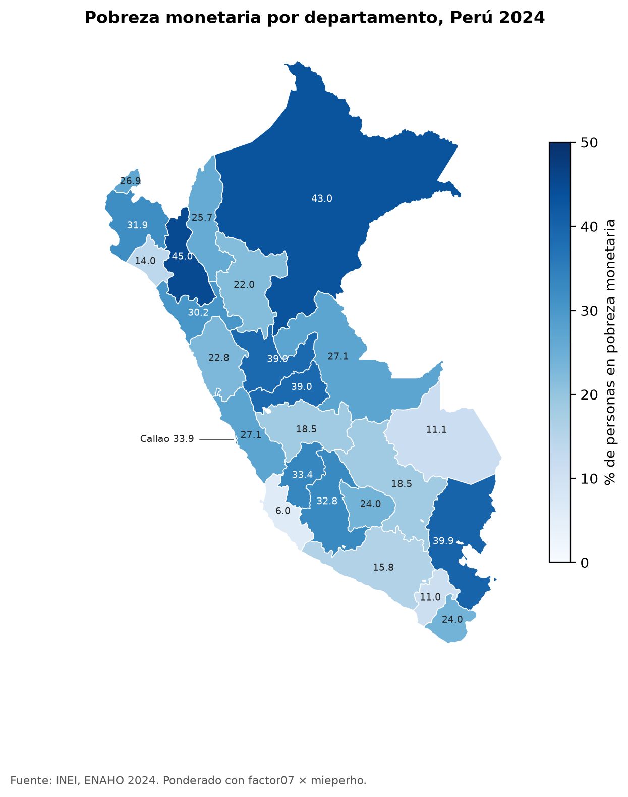
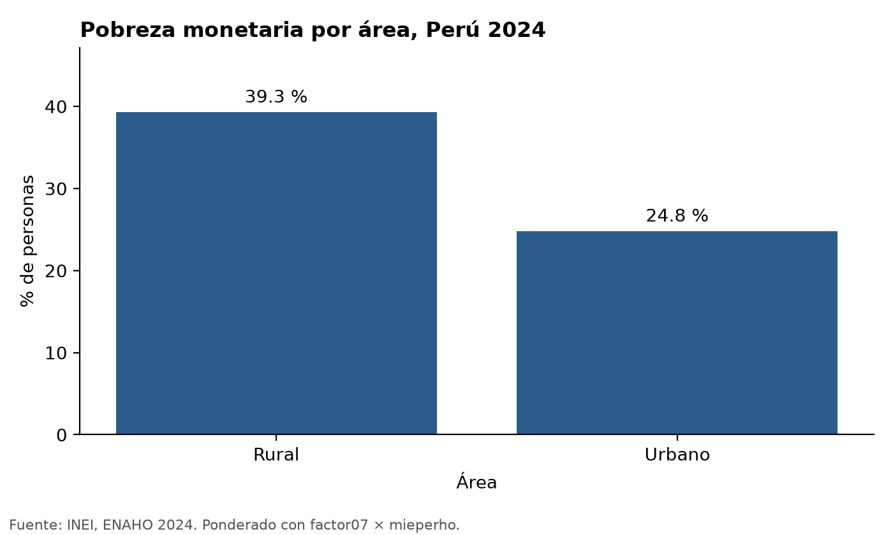
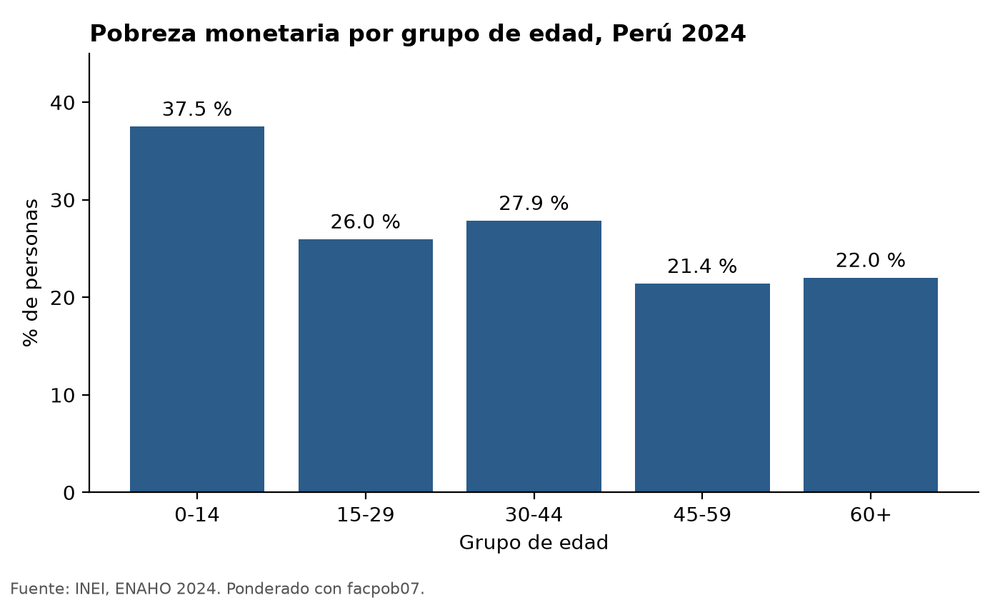

# Skills de Claude Code para la ENAHO 2024

Tres skills que limpian, grafican y mapean la ENAHO del INEI, siempre de la misma forma. La limpieza replica la
pobreza oficial de 2024 (27.6 %). Proyecto de la
[sesión 16](https://github.com/d2cml-ai/Data-Science-Python/tree/main/sessions/16-skills-enaho) del curso Data Science
con Python.

| Skill | Entra | Sale |
|---|---|---|
| [`limpiando-enaho`](.claude/skills/limpiando-enaho/SKILL.md) | `datos/966-Modulo34.zip`, `datos/966-Modulo02.zip` | `salidas/personas_2024.parquet`, `salidas/validacion.txt` |
| [`graficando-enaho`](.claude/skills/graficando-enaho/SKILL.md) | La base limpia y un grupo: área, sexo, edad o dominio | `figuras/*.png` |
| [`mapeando-enaho`](.claude/skills/mapeando-enaho/SKILL.md) | La base limpia y el GeoJSON de departamentos | `mapas/pobreza_departamento.png` |

Las skills de gráficos y mapas dicen «Si no existe `salidas/personas_2024.parquet`, usa primero la skill
`limpiando-enaho`», así que un solo pedido activa dos skills seguidas.

## 1. Instalar

Requiere [uv](https://docs.astral.sh/uv/) y [Claude Code](https://code.claude.com).

```bash
git clone https://github.com/ValMur123/skill.git && cd skill
uv sync
```

## 2. Bajar los datos

Bajen estos dos zip del portal de microdatos del INEI (código 966 = ENAHO 2024) y pónganlos **sin descomprimir** en
`datos/`. La carpeta `datos/` está en `.gitignore`.

| Módulo | Link | Tamaño |
|---|---|---|
| 34 · Sumaria | https://proyectos.inei.gob.pe/iinei/srienaho/descarga/STATA/966-Modulo34.zip | 16 MB |
| 02 · Miembros | https://proyectos.inei.gob.pe/iinei/srienaho/descarga/STATA/966-Modulo02.zip | 6 MB |

El GeoJSON de departamentos lo baja solo `mapear.py` a `datos/` si falta.

## 3. Correr

Con Claude Code, desde la raíz del repo:

```text
/limpiando-enaho 2024
Haz un mapa de la pobreza por departamento con la ENAHO 2024
Grafica la pobreza urbana y rural
```

O sin Claude, los mismos scripts:

```bash
uv run .claude/skills/limpiando-enaho/scripts/limpiar.py --anio 2024
uv run .claude/skills/graficando-enaho/scripts/graficar.py --por area      # area | sexo | edad | dominio
uv run .claude/skills/mapeando-enaho/scripts/mapear.py
```

## Validación

[`salidas/validacion.txt`](salidas/validacion.txt):

| Cifra | Resultado | INEI |
|---|---|---|
| Pobreza monetaria (sumaria, `factor07 × mieperho`) | 27.58 % | 27.6 % |
| Pobreza extrema | 5.50 % | 5.5 % |
| Pobreza con personas y `facpob07` | 27.53 % | — |
| Residentes habituales | 108,664 de 117,721 | 108,664 |
| Hogares | 33,691 | 33,691 |
| Urbano / rural | 24.8 % / 39.3 % | 24.8 % / 39.3 % |
| Los 25 departamentos | coinciden con [la referencia del curso](https://github.com/d2cml-ai/Data-Science-Python/blob/main/sessions/16-skills-enaho/referencias/pobreza_departamento_2024.csv) al decimal | |

### Decisiones fijas en los scripts

- Llaves (`conglome`, `vivienda`, `hogar`, `codperso`) y `ubigeo` como texto, con sus ceros.
- Nombres de columna normalizados: `aÑo` pasa a `anio`.
- Residentes habituales: `(p204 == 1 & p205 == 2) | (p204 == 2 & p206 == 1)`.
- Unión personas → hogar con `validate="m:1"`; el script verifica que no se pierdan ni dupliquen filas.
- `pobre = pobreza <= 2`; nunca se promedia el código.
- Ponderación: cifras del hogar (nacional, área, dominio, departamento) con un registro por hogar y
  `factor07 × mieperho`, que es como publica el INEI; cifras de la persona (sexo, edad) con `facpob07`.
- Mapas: unión por código `ubigeo[:2]` = `FIRST_IDDP`, 25 departamentos con dato, Lima y Callao separados,
  escala `Blues` desde 0.

## Figuras

| | |
|---|---|
|  |   |

## Evaluación

Tres pedidos corridos con `claude -p`, con y sin skills (`--disallowedTools Skill`): ver
[`evaluacion.md`](evaluacion.md).

## Estructura

```text
.claude/skills/
  limpiando-enaho/   SKILL.md, reference.md, scripts/limpiar.py
  graficando-enaho/  SKILL.md, scripts/graficar.py
  mapeando-enaho/    SKILL.md, scripts/mapear.py
salidas/validacion.txt      # la base .parquet no se sube: se regenera con limpiar.py
figuras/  mapas/
evaluacion.md  README.md  pyproject.toml  uv.lock
```

Fuente: INEI, Encuesta Nacional de Hogares 2024.
